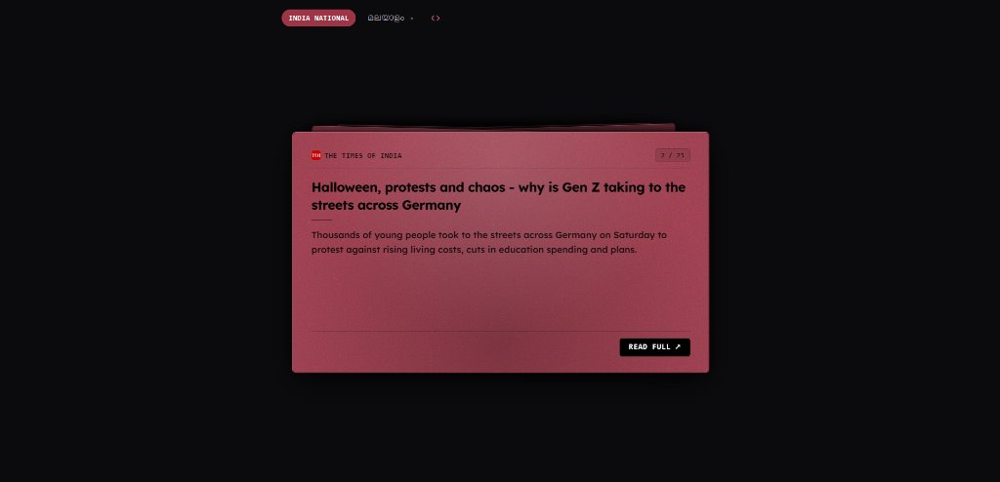
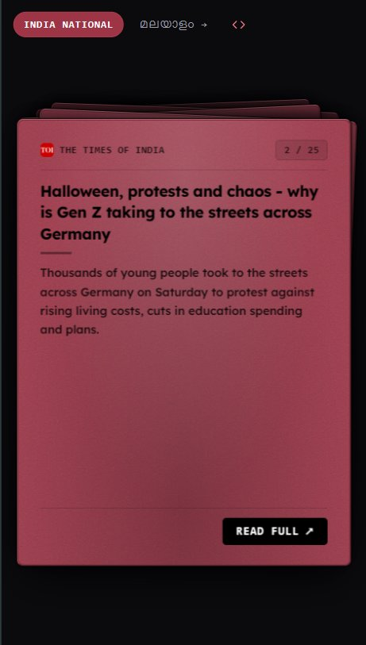

# 📰 News FlipCard

> A tactile, minimalist 3D card-stack news reader delivering concise, AI-summarized headlines in English and Malayalam. Built with local NLP models, zero external LLM API costs, and native embed support for any website.

[](https://news-flashcard-9ad00f891023.herokuapp.com/)
[](https://fastapi.tiangolo.com)
[](https://nextjs.org/)
[](https://pytorch.org/)
[](https://huggingface.co/google-t5/t5-small)
[](LICENSE)

---

## 📸 Preview

| Desktop Experience | Mobile Card Stack |
| :---: | :---: |
|  |  |

---

## ✨ Highlights & Features

- 🃏 **Tactile 3D Card Stack Illusion**:
  - Immersive physical deck simulation with subtle fanning, multi-sided paper rim highlights, and cast drop-shadows.
  - Fully responsive: fine-tuned fanning on desktop and peeking card offsets on mobile.
  - Drag, swipe, or click to draw the next card with fluid physics-based transitions.
  - Classic Matte Burgundy (`#9e3547`) styling with warm film-grain paper texture.

- 🌐 **Dual-Language Support**:
  - **India National (English)**: Top national and world headlines curated from major publications.
  - **കേരള വാർത്തകൾ (Malayalam)**: Regional Kerala headlines with full Unicode Malayalam rendering.

- 🧠 **100% Local NLP Summarization (Zero External LLM APIs)**:
  - **English**: Summarized locally using a thread-safe singleton PyTorch pipeline powered by HuggingFace's [`google-t5/t5-small`](https://huggingface.co/google-t5/t5-small).
  - **Malayalam**: High-speed extractive summarization using a tuned Luhn frequency-scoring algorithm.
  - **Clean output**: Automatically strips agency markers (*PTI, ANI, Reuters*) and boilerplate clickbait.
  - **No external API dependency**: No OpenAI, Gemini, or OpenRouter keys needed—runs completely private and free.

- ⚡ **High-Performance Architecture (SWR + SQLite WAL)**:
  - **Stale-While-Revalidate (SWR)** caching: Instant sub-second page loads from disk, while a background worker refreshes the feed asynchronously.
  - **SQLite WAL Mode (`redis_cache.db`)**: Atomic transactions with low memory overhead, resilient to concurrent reads.
  - Resilient scrapers with connection pooling and automated fallback parser engines (`selectolax` & `BeautifulSoup4`).

- 🔌 **Embed Anywhere**:
  - Turn News FlipCard into an interactive widget for blogs, portals, or docs with the built-in embed generator (`<>` icon).

---

## 🔌 Embedding News FlipCard on External Websites

You can embed the live card stack directly into any web application or site using an `<iframe>`, our lightweight standalone script widget, or as a React component.

Click the **`<>` (Embed)** button in the top navigation bar to open the interactive code generator, or use one of the snippets below:

### 1. Standard `<iframe>` Embed (Recommended)
Paste this anywhere in your HTML:

```html
<iframe
  src="https://news-flashcard-9ad00f891023.herokuapp.com/embed?lang=en&theme=dark"
  width="100%"
  height="540"
  frameborder="0"
  style="border:none; border-radius:12px; overflow:hidden;"
  allow="clipboard-write"
  title="News FlipCard Widget"
></iframe>
```

### 2. Standalone JavaScript Widget (`embed.js`)
Include the container placeholder and our asynchronous script tag:

```html
<!-- News FlipCard Widget Container -->
<div
  id="news-flipcard"
  data-lang="en"
  data-theme="dark"
  data-height="540px"
></div>

<!-- Widget Loader -->
<script src="https://news-flashcard-9ad00f891023.herokuapp.com/embed.js" async></script>
```

### 3. Direct React / Next.js Component
If integrating within a React project:

```tsx
import { NewsFlipCard } from "@/components/NewsFlipCard";

export default function NewsWidget() {
  return (
    <div style={{ maxWidth: 680, margin: "0 auto" }}>
      <NewsFlipCard lang="en" theme="dark" auto={false} />
    </div>
  );
}
```

### URL Query Parameters

| Parameter | Type | Default | Description |
| :--- | :--- | :--- | :--- |
| `lang` | `en` \| `ml` | `en` | Selects headline language (`en` for English, `ml` for Malayalam). |
| `theme` | `dark` \| `light` | `dark` | Visual backdrop theme. |
| `auto` | `boolean` | `false` | When `true`, automatically cycles to the next card every 8 seconds. |

---

## 🏗️ Project Architecture

```
news-flipcard/
├── assets/                       # Screenshots and visual media for documentation
│   ├── desktop-preview.jpg
│   └── mobile-preview.jpg
├── Backend/                      # FastAPI Python Application
│   ├── main.py                   # App entrypoint, middleware, static SPA router
│   ├── config.py                 # Central configuration and environment constants
│   ├── scrapers/                 # Specialized & modular news scraping package
│   │   ├── __init__.py           # Package re-exports and registry
│   │   ├── base.py               # Session pooling, headers, cleaners & BaseSiteScraper
│   │   ├── google_news.py        # Google News feed fetcher & batchexecute URL decoder
│   │   ├── manorama.py           # Manorama Online scraper
│   │   ├── mathrubhumi.py        # Mathrubhumi scraper
│   │   ├── asianet.py            # Asianet News Malayalam scraper
│   │   ├── news18.py             # News18 Malayalam scraper
│   │   ├── madhyamam.py          # Madhyamam scraper
│   │   ├── the_hindu.py          # The Hindu scraper
│   │   ├── times_of_india.py     # The Times of India scraper
│   │   ├── ndtv.py               # NDTV scraper
│   │   ├── indian_express.py     # The Indian Express scraper
│   │   ├── generic.py            # JSON-LD & OpenGraph multi-source fallback
│   │   └── news_scraper.py       # High-level parallel orchestrator
│   ├── services/                 # Core domain logic
│   │   ├── __init__.py
│   │   └── news_service.py       # SWR orchestrator, title normalizer, background tasks
│   ├── storage/                  # Persistence & caching
│   │   ├── __init__.py
│   │   └── cache.py              # SQLite WAL persistent cache implementation
│   └── summarizers/              # NLP & ML summarization engines
│       ├── __init__.py
│       ├── extractive.py         # Malayalam frequency-scoring summarizer
│       └── t5.py                 # HuggingFace T5-small singleton summarizer
├── frontend/                     # Next.js 15 SPA Frontend
│   ├── public/                   # Static assets, embed.js loader
│   ├── src/
│   │   ├── app/
│   │   │   ├── page.tsx          # English news home page
│   │   │   ├── malayalam/        # Malayalam news page
│   │   │   └── embed/            # Isolated standalone embed view
│   │   └── components/
│   │       ├── CardSwap.tsx      # 3D interactive card stack engine
│   │       ├── EmbedModal.tsx    # Modal for generating embed snippets
│   │       └── NewsFlipCard.tsx  # Standalone embed card component
│   └── package.json
├── Procfile                      # Heroku deployment execution command
├── requirements.txt              # Production Python dependencies
└── runtime.txt                   # Target Python runtime (Python 3.11.x)
```

---

## 🚀 Getting Started

### Prerequisites
- **Python 3.10+** (Python 3.11 recommended)
- **Node.js 18+** & **npm**

### 1. Clone the Repository
```bash
git clone https://github.com/shinas101/NewsFlashcard.git
cd news-flipcard
```

### 2. Backend Setup
```bash
# Create and activate a virtual environment
python -m venv venv
# On Windows:
.\venv\Scripts\activate
# On Linux/macOS:
source venv/bin/activate

# Install backend dependencies
pip install -r requirements.txt

# Run the FastAPI development server
uvicorn main:app --host 127.0.0.1 --port 8000 --reload --app-dir Backend
```
The API documentation will be available at `http://127.0.0.1:8000/docs`.

### 3. Frontend Setup
In a new terminal:
```bash
cd frontend
npm install
npm run dev
```
Open `http://localhost:3000` to view the development frontend with Hot-Module-Reloading.

---

## 🛠️ Production Build & Single-Dyno Deployment

The repository is configured to serve the compiled Next.js static export (`frontend/out`) directly from FastAPI, enabling deployment on a single cloud dyno (e.g., Heroku, Render, Fly.io, Railway) with zero CORS issues.

### Compile Frontend & Run Production Server
```bash
# 1. Build the Next.js static bundle
cd frontend
npm run build
cd ..

# 2. Launch production ASGI server
uvicorn main:app --host 0.0.0.0 --port 8000 --workers 1 --app-dir Backend
```

### Heroku Deployment
The included `Procfile` executes:
```procfile
web: uvicorn main:app --host 0.0.0.0 --port ${PORT:-8000} --workers 1 --app-dir Backend
```

---

## 📡 API Reference

### Get Summarized News
```http
GET /api/news?lang={en|ml}&refresh={true|false}
```
**Query Parameters:**
- `lang` *(string, default: `"en"`)*: `"en"` for English news, `"ml"` for Malayalam.
- `refresh` *(boolean, default: `false`)*: Bypass cache and trigger synchronous regeneration.

**Sample Response:**
```json
{
  "status": "success",
  "source": "cache",
  "language": "en",
  "cached_at": "2026-11-01T06:30:00Z",
  "count": 25,
  "articles": [
    {
      "title": "Halloween, protests and chaos - why is Gen Z taking to the streets across Germany",
      "summary": "Thousands of young people took to the streets across Germany on Saturday to protest against rising living costs, cuts in education spending and plans.",
      "source": "The Times of India",
      "link": "https://timesofindia.indiatimes.com/...",
      "published": "2 hours ago"
    }
  ]
}
```

### Health Check
```http
GET /api/health
```
Returns system uptime, cache status, and ML model availability.

---

## 📜 License

This project is licensed under the [MIT License](LICENSE).

